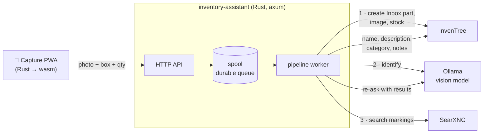

# Inventory Assistant

**Photograph a part, drop it in a box, move on. A local AI names it, categorises it and looks up its datasheet in [InvenTree](https://inventree.org) for you.**

Inventory Assistant is a self-hosted companion app for InvenTree, built for the job everyone puts off: cataloguing
the drawers of modules, boards, cables and bits that a maker, lab or small workshop builds up over the years.
You don't type anything per part. Pick a box once, then *snap, drop, snap, drop*. Each photo is in InvenTree within
seconds. A vision model running on your own hardware identifies it in the background, and when it can read
part numbers it searches the web for them and checks its answer against what it finds.

No cloud APIs, no keys, and no per-item cost. Your photos never leave your network.

<!-- TODO: docs/images/capture.png (phone UI) and docs/images/inbox.png (InvenTree result) -->

## Highlights

- **Photo-first, zero typing.** A thumb-sized PWA: one big shutter button, a sticky "current box" (create new
  boxes, including nested ones like `B1/cables`, on the spot) and −/+/+10 quantity. Photos are downscaled on the phone and
  upload in the background, and a failed upload is kept for one-tap retry.
- **Never blocks on AI.** Uploads go to a durable on-disk queue and become InvenTree parts (category *Inbox*, photo
  as the part image, stock at the box) right away. Identification catches up afterwards, and a restart loses nothing.
- **Local vision model.** Any Ollama vision model (default `qwen3.5:4b`, about 10 s per photo on a CPU). It reads the
  markings, then names, describes and categorises the part.
- **Grounded by web research.** Part-number-like markings (`ZS-040`, `HT46R47`, `LM2596S`) are searched on a
  self-hosted [SearXNG](https://docs.searxng.org). The model then looks again with the photo *and* the results, and the
  sources are linked in the part's notes.
- **Honest about confidence.** Low-confidence guesses stay in *Inbox* for a human to check. Every AI name is
  labelled as a guess, with the model, its confidence and what it read.
- **Uses InvenTree's own login.** The capture UI works with your normal InvenTree session (through the reverse
  proxy's `forward_auth`), so it has no separate accounts or passwords.
- **Bulk import, too.** [`tools/yaml-import`](tools/yaml-import) loads an existing hand-written catalogue (YAML +
  photos) idempotently. Re-run it as often as you like and UI edits are never overwritten.

## How it works



Each capture moves through `queued → stored → (research →) named`, or ends up `unnamed` and stays in *Inbox*.
Storing always takes priority over naming, so a burst of 50 photos shows up in InvenTree straight away and the
names follow. See [docs/architecture.md](docs/architecture.md) for the details.

## Quick start

You need Docker and a machine that can run [Ollama](https://ollama.com) (CPU is fine; a GPU is faster).

```sh
git clone https://github.com/inosion/inventory-assistant && cd inventory-assistant/deploy
cp env.example .env && $EDITOR .env          # SITE_HOST, passwords, SEARXNG_SECRET
ollama pull qwen3.5:4b                        # on the Docker host (or use --profile ollama)
docker compose up -d
```

1. Open `https://<SITE_HOST>:8443/`, log in as the admin from `.env`, and create an API token
   (*user menu › Account settings › Access tokens*). Put it in `.env` as `ASSISTANT_INVENTREE_TOKEN`, then
   run `docker compose up -d` again.
2. On your phone, open `https://<SITE_HOST>:8443/capture/` and add it to the home screen.
3. Tap **Box**, type `A1`, tap **Snap**. Then watch *Parts › Inbox* in InvenTree.

Already running InvenTree? Add just the `inventory-assistant` and `inventree-searxng` services and the `/capture/`
route from [deploy/Caddyfile](deploy/Caddyfile) to your setup. [docs/deployment.md](docs/deployment.md) covers
TLS, existing installs and upgrades.

## Configuration

| Variable | Default | |
|---|---|---|
| `INVENTREE_URL` | `http://inventree-server:8000` | InvenTree base URL (internal) |
| `INVENTREE_TOKEN` | *(required)* | API token of a user allowed to add parts, stock and locations |
| `OLLAMA_URL` | `http://localhost:11434` | Ollama endpoint |
| `OLLAMA_MODEL` | `qwen3.5:4b` | Any vision-capable Ollama model |
| `SEARXNG_URL` | *(unset = no research)* | SearXNG with the JSON format enabled |
| `RESEARCH_POLICY` | `markings` | `markings`: research everything with part numbers · `low`: only low-confidence items · `off` |
| `DATA_DIR` | `./spool` | Queue directory (keep it on a volume) |
| `LISTEN` | `0.0.0.0:3000` | Bind address |
| `RUST_LOG` | `info` | Log filter |

## Accuracy: what to expect

The AI names are drafts. In testing on a real parts bin with a 4B model, common modules (Arduino Nano, HC-05
Bluetooth) were named correctly. Unusual boards were sometimes misnamed even after research, because a small
model will sometimes "read" markings that aren't there. The design accepts this: everything lands in
InvenTree immediately, anything uncertain stays in *Inbox*, and every guess records its evidence. **A larger vision
model is the biggest single improvement.** Change `OLLAMA_MODEL` and nothing else needs to change.

## Repository layout

```
crates/server/       inventory-assistant service: API, spool, pipeline, InvenTree/Ollama/SearXNG clients
crates/web/          capture PWA (Leptos, compiled to wasm, built with trunk)
deploy/              docker compose stack: InvenTree + assistant + SearXNG + Caddy
tools/yaml-import/   bulk importer for an existing YAML catalogue
docs/                architecture, deployment
```

## Development

Needs Rust (stable), the `wasm32-unknown-unknown` target and [trunk](https://trunkrs.dev).

```sh
cargo test --workspace
cargo clippy --workspace --all-targets -- -D warnings

# run locally against any InvenTree, UI at http://localhost:3000/
(cd crates/web && trunk build)
INVENTREE_URL=https://inventree.example.lan INVENTREE_TOKEN=… cargo run -p inventory-assistant
```

See [CONTRIBUTING.md](CONTRIBUTING.md).

## Roadmap

- Review screen in the PWA: accept, rename or recategorise Inbox items without opening InvenTree
- Configurable category list and prompts (currently tuned for electronics and maker parts)
- Multi-photo captures (front and back of a board)
- Optional OpenAI-compatible endpoint (vLLM, llama.cpp server) alongside Ollama
- Native InvenTree plugin packaging

## License

[MIT](LICENSE) © Ramon Buckland / inosion
